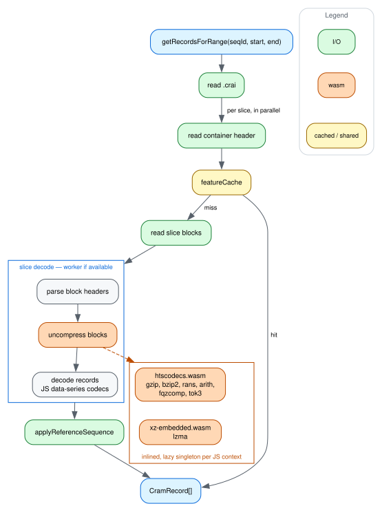

# How a query flows

[dataflow.dot](img/dataflow.dot) is the source; see
[CONTRIBUTING.md](../CONTRIBUTING.md) for how to re-render it.

A query turns its range into a list of `.crai` slice entries, and from there
every slice runs in parallel. Each slice:

- Resolves its container — the header and compression header block, memoized for
  the query, since a container holds several slices.
- Asks `featureCache` for the decoded records. A hit returns them already
  decoded and decorated with their reference, so a repeat query runs only the
  filter.
- On a miss, reads the whole block region in one go and decodes it: walk the
  blocks, decompress each by its method byte, build the per-slice decode
  context, then make one pass over the records into the read-feature arena and
  the tag and quality columns.

[optimizations.md](optimizations.md) explains why each of those steps works the
way it does, with the measurements behind it, and the [ADRs](adr/) record the
decisions in full.

The diagram draws only the main path, and leaves out:

- the file definition and SAM header, memoized per file, so every query after
  the first finds them already resolved;
- non-indexed access through `CramFile` directly, which walks containers and
  reads each slice in one range;
- the mate pass re-entering the index and the cache for slices it did not
  already have;
- cache eviction, which is LRU plus an idle sweep.

## Diagram notes

- **The decode output.** The record pass writes per-slice typed columns, not an
  object per read feature, and each record is a view onto them.
  [memory.md](memory.md#columns-not-objects) has the costs, and
  [api.md](api.md#read-features) shows how to read the columns directly.
- **The purple box.** Everything in it runs on a worker pool when the host has
  one, and in-process otherwise. The unit of work is the whole slice, where
  [bam-js](https://github.com/GMOD/bam-js/blob/main/docs/dataflow.md) pools only
  decompression. [workers.md](workers.md) has the measurements and the
  fallbacks.
- **The main thread.** Two steps stay on it even with a worker pool: describing
  the slice to the worker, because a `CramFile` holds a filehandle and your
  `fetchReferenceSequence` callback, and `applyReferenceSequence`, which calls
  that callback.
- **The orange nodes.** Everything orange is wasm: htscodecs for the CRAM
  codecs, libdeflate for gzip, the emscripten port for bzip2, and xz-embedded
  for lzma. The `.crai` goes through wasm too, because it is gzipped, though the
  diagram leaves out that edge. Code crosses the boundary once per block, never
  per record. [wasm.md](wasm.md) has the argument and the
  [codec list](wasm.md#codecs).
