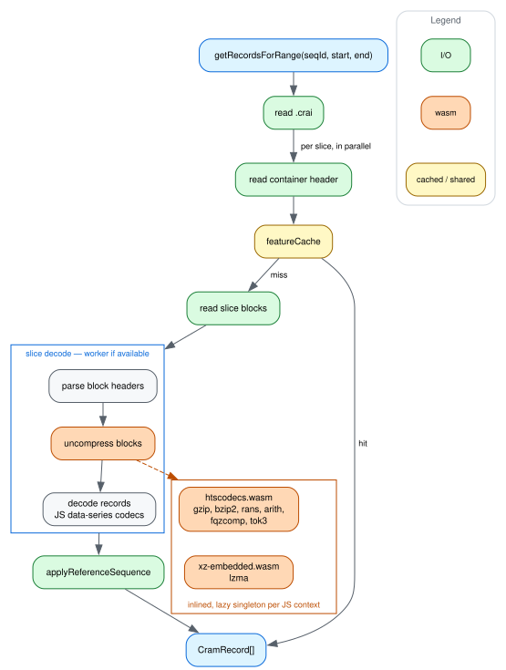

# How a query flows

[dataflow.dot](img/dataflow.dot) is the source; see
[CONTRIBUTING.md](../CONTRIBUTING.md) for how to re-render it.

A query turns its range into a list of `.crai` slice entries, and from there
every slice runs in parallel. Each slice:

- Resolves its container — the header and compression header block, memoized for
  the query, since a container holds several slices.
- Asks `featureCache` for the decoded records. A hit returns them already
  decoded and decorated with their reference, so a repeat query runs only the
  filter.
- On a miss, reads the whole block region in one go and decodes it: walk the
  blocks, decompress each by its method byte, build the per-slice decode
  context, then make one pass over the records into the read-feature arena and
  the tag and quality columns.

[optimizations.md](optimizations.md) explains why each of those steps works the
way it does, with the measurements behind it, and the [ADRs](adr/) record the
decisions in full.

The diagram draws only the main path, and leaves out:

- the file definition and SAM header, memoized per file, so every query after
  the first finds them already resolved;
- non-indexed access through `CramFile` directly, which walks containers and
  reads blocks one at a time;
- the mate pass re-entering the index and the cache for slices it did not
  already have;
- cache eviction, which is LRU plus an idle sweep.

## What the decode writes into

The record pass writes typed columns, not `{code, pos, refPos, data}` objects:

- read features go into a per-slice arena of struct-of-arrays typed columns, and
  each record holds a start and a count into them;
- tags and quality scores go into separate columns.

Read features dominate decoded-record memory on long reads (a 37-record ONT
slice decodes 213k of them), and 15 bytes of columns per feature against 64 per
object determines whether a slice fits in the cache at all.

Two later steps depend on the columnar layout:

- The arena is sized up front from the slice's blocks, because a long-read slice
  whose arena grows spends its decode time reallocating seven columns.
- Typed arrays let a worker transfer the result at zero copy instead of
  structured-cloning an object graph.

[memory.md](memory.md#columns-not-objects) has the per-column costs,
[api.md](api.md#read-features) how to read them without materializing anything.

## Where the slice decode happens

Everything in the purple box runs on a **worker pool** when the host has one.
The pool launches each `Worker` from a Blob URL, and the package inlines the
worker code with the wasm inside it, so there is nothing to configure. One pool
serves the whole JS context, as in
[bam-js](https://github.com/GMOD/bam-js/blob/main/docs/dataflow.md), but the
unit of work is the **whole slice** rather than just decompression. Block
decompression accounts for only 24–35% of a cold query, so a decompression-only
pool caps out around 1.33x, where the whole-slice pool measures 2.0–3.6x. That
is why the diagram draws a box around several steps here and bam's draws a
single node. A host that cannot start a pool runs the same code in-process, on
the thread that called it.

Two things stay on the main thread whatever happens:

- Describing the slice to the worker, in bytes and numbers only. A `CramFile`
  holds a filehandle and your `fetchReferenceSequence` callback, and neither can
  be posted to a worker. In the other direction, the worker transfers the
  columns back at zero copy instead of cloning them.
- `applyReferenceSequence`, because resolving substitutions means calling that
  callback.

[workers.md](workers.md) has the measurements and the fallbacks.

## Where wasm sits

Everything orange is wasm:

- `htscodecs.wasm` handles gzip (through libdeflate), bzip2, and every CRAM
  codec from rANS to fqzcomp and tok3.
- A second `xz-embedded.wasm` handles lzma, which htscodecs has no codec for at
  all.

The build inlines both, and each instantiates lazily, once per JS context. The
`.crai` goes through wasm too, though the diagram does not draw that edge — the
index is gzipped, so the first wasm call of a session is usually gunzipping it
rather than decompressing a block.

The code crosses the boundary **once per block, never per record**. Each
crossing copies its input into the wasm heap and its output back out, and a
block's two copies amortize over the thousands of records in it. The layers
above the block, meaning the data-series codecs, the record decode and the
columns, run in JS on bytes already in the JS heap. [wasm.md](wasm.md) has the
rest of that argument, and [wasm.md](wasm.md#codecs) the codec list.
